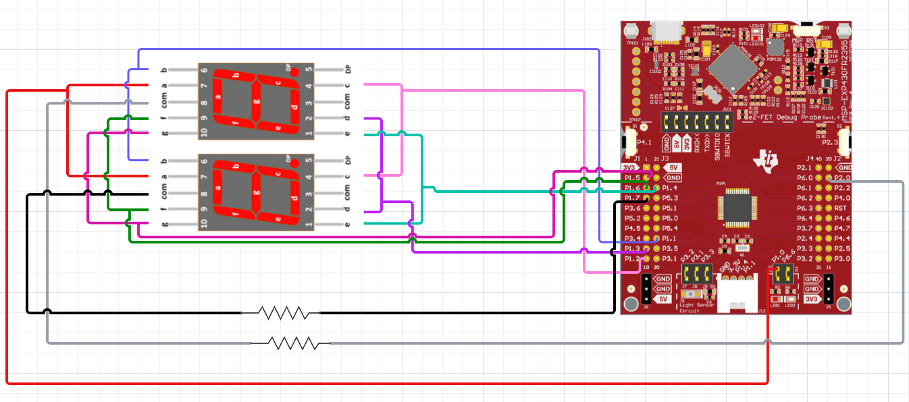

# MSP430 Seven-Segment Timer

MSP430 assembly counter that displays **00 to 59** on two multiplexed seven-segment displays, then wraps back to **00**. Timer B controls display refresh and the approximate one-second count.

[Watch the original hardware demo on YouTube](https://www.youtube.com/watch?v=_E-E48lryDo)

## Wiring diagram

## How it works

- **R11/R12** hold the units/tens digits. **R10** selects which display to refresh.
- **R13** counts Timer B overflows; after **254**, the displayed number advances.
- **R14/R15** convert each digit into an active-low seven-segment pattern.
- **P1** drives segments and one digit-select line; **P2.0** selects the other display.

The code assumes a **32,768 Hz ACLK**. Reloading Timer B to **65,407** leaves 129 ticks until overflow: **129 / 32768 = 3.937 ms** per refresh. At 254 overflows, that's about **1.000 s**, before instruction and interrupt overhead. Timing is approximate rather than calibrated.

## Build and run

Open `src/timer.asm` in a TI Code Composer Studio MSP430 assembly project. Build and flash the program using the MSP430 toolchain. The two displays share the segment lines, with separate digit-select outputs.

`original/timer_report_baseline.asm` is a reconstruction of the assembly printed on pages 8-12 of the original report. `src/timer.asm` is the cleaned version. No third-party assembly libraries are required beyond the device header and linker definitions from the chosen CCS target.

## Background

Developed by Abdul Nafeh for an embedded systems assignment at the University of South Florida. The original assembly was recovered from the submitted report and later cleaned up for this repository.